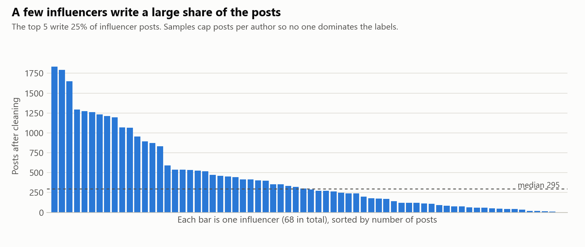
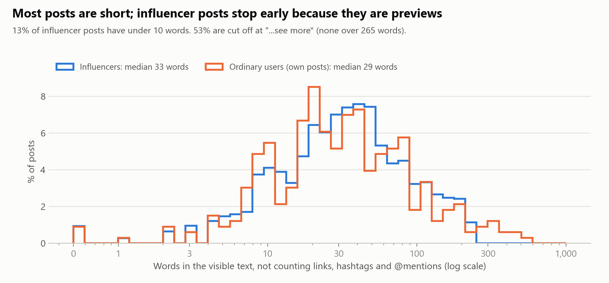
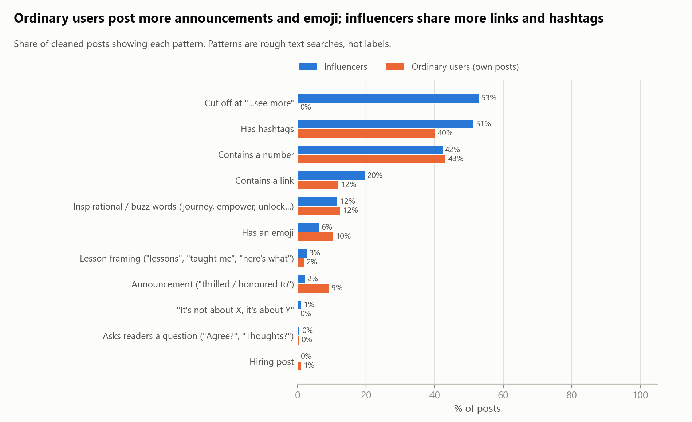
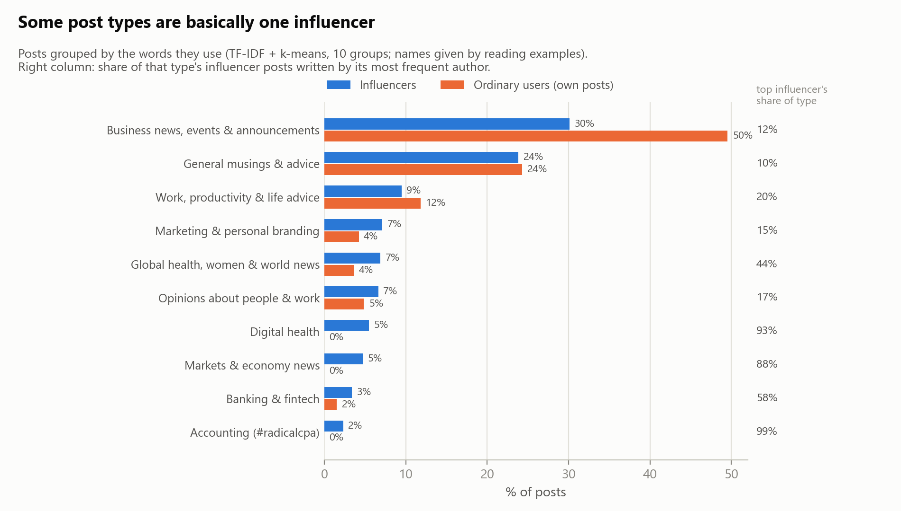
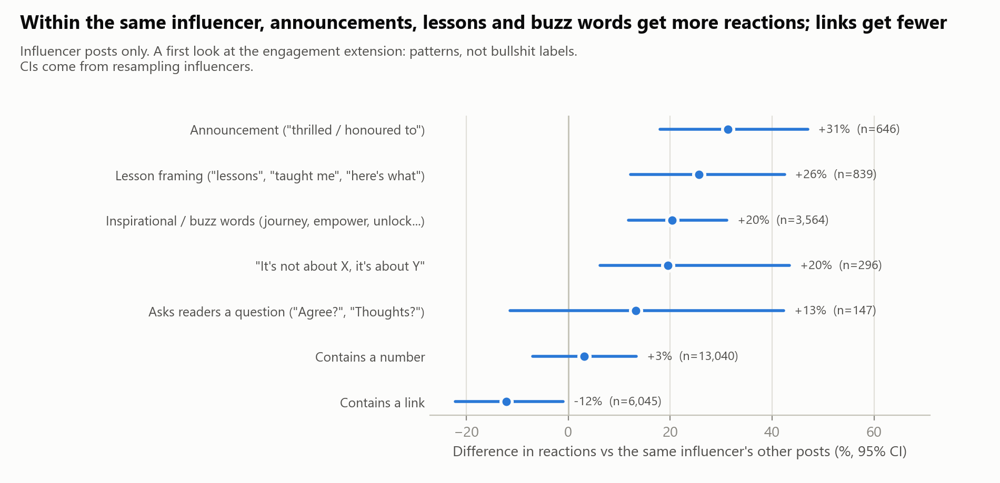

# Overview EDA: what's in the cleaned data

Run on 2026-10-11 with `python eda/overview/overview_eda.py`, after `python src/clean.py`.
Raw numbers are in `overview_summary.json`; charts are in `figures/`.
The concreteness analysis has its own write-up: `eda/concreteness/concreteness_eda.md`.

## The short version

- We have **31,498 posts**:
  - 30,864 from 68 influencers;
  - 634 from ordinary users on Figshare: 329 they wrote themselves, and 305 reposts of other people's posts.
- **The influencer data is lopsided.** A few people wrote a lot of it, about half of it is previews cut off at "…see more", and some topics are basically one person.
- **The ordinary-user data is narrow.** It's mostly people around Dallas–Fort Worth sharing job news from 2023–24.
- **Likes tell you who posted, not how good the post is.** Don't use them as a stand-in for "bullshit".
- **Bullshit looks like a minority**: 18 of the 60 pilot posts (30%), and even that is with likely-bullshit posts mixed in on purpose.

## 1. Data quality

- **Missing values:** almost none. Only 0.1% of influencer posts lack a follower count.
  - `reposts` only exists for Figshare.
  - `media_type` is "unknown" for Figshare, because that dataset didn't record attachments.
- **Followers is one snapshot per person**, taken when the data was collected, not at the time of each post.
- Cleaning problems (duplicates, other languages, junk text) are covered in `DECISION_LOG.md` §6.

## 2. How old the posts are

- **Influencers:** the dates are only relative ("1 year ago"), measured from when the data was collected (about 2021).
  - 42% were posted under a year before collection, 23% one year before, 28% two to three years before, and 7% four or more.
  - So these are roughly 2017–2021 posts, mostly from before ChatGPT.
- **Ordinary users:** 500 of 634 posts are from 2023–24. A few go back to 2013.
- **So what:** the two datasets come from different eras of LinkedIn. If a model works on one and not the other, the time gap could be part of the reason.

## 3. Who wrote the posts

- The median influencer has 295 posts. The range is 4 to 1,834.
- The top 5 wrote 25% of all influencer posts.
- **So what:**
  - when testing a model, keep each person's posts all on one side (all training or all testing), so the model can't score well by recognising authors;
  - when sampling posts for labelling, cap posts per person (we already cap at 5).

## 4. How long the posts are

- **Typical posts are short:** median 33 words for influencers and 29 for ordinary users (not counting links, hashtags and @mentions).
- **Very short posts are common:** 13% of influencer posts and 14% of ordinary users' posts have under 10 words. About 1% are only hashtags or a link.
  - We **keep all of them** now. Short maxims ("Learn first. Teach second. Never dictate.") can be bullshit.
- **53% of influencer posts are cut off at "…see more".** None is longer than 265 words, because only the preview was saved.
  - The cut-off posts are the long ones: median 58 words, vs 16 for posts that weren't cut.
- **Reposts are longer** (median 63 words), because they're mostly company posts.

## 5. What the posts contain

These are rough text searches, not labels.

- **Ordinary users announce more:** 9% use "thrilled / honoured to…", vs 2% of influencer posts. They also use emoji more (10% vs 6%).
- **Influencers share more links (20% vs 12%) and hashtags (51% vs 40%).**
- **Inspirational or buzz words** (journey, empower, unlock…) appear in about 12% of posts in both groups.
- **Classic bullshit phrases are rare:** lesson framing in 3% of influencer posts, "not X but Y" in 1%. Phrase-matching can't find most bullshit, which is why we need labels.
- **Attachments (influencers):** 46% link an article, 26% an image, 9% a video, and 19% have nothing attached. Lots of posts are teasers, which is why the rubric says to judge only the text.

## 6. Common words

| | Most common words (share of posts) | Most common phrases |
|---|---|---|
| Influencers | new 11%, time 11%, people 10%, work 8%, make 7%, think 7%, world 7% | digital health, social media, artificial intelligence, "today's column", wall street |
| Ordinary users (own posts) | new 24%, share 16%, **dallas 15%**, team 13%, happy 13%, opportunity 12%, thank 11% | **fort worth 10%**, "happy to share" 9%, "new position" 8%, "starting a new" 6%, real estate 3% |

- **Ordinary users' posts are mostly job news**: "Happy to share I'm starting a new position…", mainly around Dallas–Fort Worth. Under our rubric that's mundane, not bullshit. So the low bullshit rate for ordinary users partly reflects *what this dataset happens to contain*, not ordinary users in general.
- **Influencers' top hashtags:** #technology, #digitalhealth, #healthcare, #economy, #leadership.

## 7. Types of posts

We grouped posts by the words they use, to see what kinds of posts there are. This is the "explore the data and embeddings first" step mentors suggested.
- **Method:** TF-IDF word weights → 100 dimensions → k-means with 10 groups. TF-IDF is a quick stand-in for sentence embeddings, which aren't installed yet.
- **Names:** we gave each group a name by reading example posts.

| Post type | Influencers | Ordinary users | Notes |
|---|---|---|---|
| Business news, events & announcements | 30% | 50% | Biggest group; mixed authors |
| General musings & advice | 24% | 24% | Mixed authors; where a lot of motivational content sits |
| Work, productivity & life advice | 9% | 12% | |
| Marketing & personal branding | 7% | 4% | |
| Global health, women & world news | 7% | 4% | 44% from one person |
| Opinions about people & work | 7% | 5% | |
| Digital health | 5% | 0% | **93% from one person** |
| Markets & economy news | 5% | 0% | **88% from one person** |
| Banking & fintech | 3% | 2% | 58% from one person |
| Accounting (#radicalcpa) | 2% | 0% | **99% from one person** |

**So what:**
- **Topic and author are tangled.** A model could learn "digital health = this author's style" instead of anything about bullshit. That's one more reason to split by author.
- **Bullshit candidates sit mostly in the advice and opinion groups.** In the pilot, 57% of "opinions about people & work" posts and 43% of "work, productivity & life advice" posts were labelled bullshit, vs 29% of business news (only 7–21 posts per group).

## 8. What the labelling pilot shows so far

Rounds 1–2, 60 posts. A post counts as bullshit when most annotators said so, using first answers only.

| Group | Posts | Labelled bullshit |
|---|---|---|
| **All** | 60 | **30%** (18 posts) |
| Picked at random | 36 | 22% |
| Picked by bullshit-ish phrases | 24 | 42% |
| Influencer posts linking an article | 19 | 53% |
| Influencer posts with no attachment | 11 | 36% |
| Influencer posts with an image | 9 | 0% |
| Ordinary users (Figshare) | 15 | 13% |
| Cut off at "…see more" | 33 | 39% |
| Not cut off | 27 | 19% |

- **Article teasers are often labelled bullshit.** That fits rule 2 (judge only the text): a hyped teaser with the content hidden in the article counts as bullshit.
- **Cut-off posts are labelled bullshit twice as often.** Possibly the hook is visible but the substance comes after "…see more". Worth keeping an eye on.
- **Concreteness, first real test (influencer posts):** bullshit posts averaged 2.86 and other posts 2.97. That's the direction we expected, but on just 16 vs 26 posts, so it's only a hint. The proper test comes once the test set is labelled.
- All of these are tiny numbers. Treat them as hints, not findings.

## 9. Engagement (first look at the extension question)

- **Raw numbers:**
  - Influencers: median 40 reactions, mean 493, max 391,498.
  - Ordinary users: median 9.
- **Who posted explains 72% of the variation in (log) reactions.** The top 5 influencers collect 81% of all reactions. So we compare each influencer's posts **with their own other posts**.
- **Within the same influencer:**
  - posts with announcements get +31% reactions;
  - lesson framing +26%;
  - "not X but Y" maxims +20%;
  - inspirational or buzz words +20%;
  - posts with links −12%;
  - numbers make no clear difference.
- **Careful:**
  - These are rough phrase searches, not our bullshit labels.
  - A correlation doesn't prove the phrase *causes* more likes.
  - Still, it hints that LinkedIn rewards the lesson and maxim style, which is exactly what our extension question asks. We'll redo it with the model's bullshit scores once we have them.

## What this means for next steps

1. **Split by author** whenever we train and test a model.
2. **Over-sample likely bullshit** when picking posts to label, and record each post's pool so we can still estimate how common bullshit really is.
3. **Report results separately** for influencers and ordinary users. They come from different years, places and kinds of posts.
4. **The test set needs short posts.** It was drawn when we still dropped posts under 10 words, so right now it has none. Fix this when we rebuild it.
5. **Never use likes as a label.** For the engagement question, always compare within the same author.
